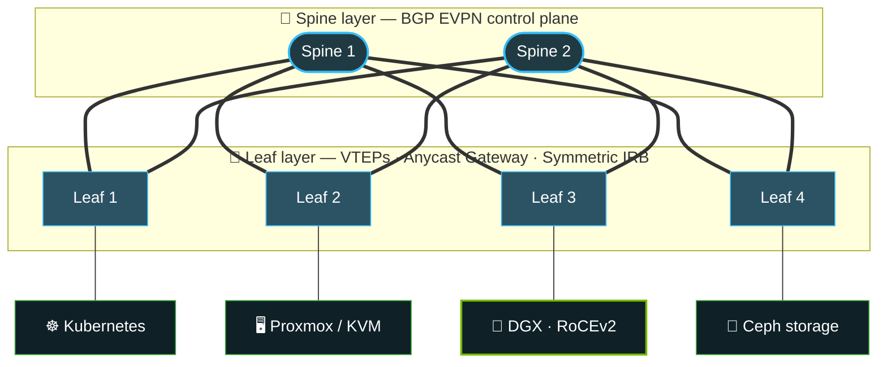

<!-- ═══════════════════════════ HEADER ═══════════════════════════ -->
<div align="center">


<a href="https://github.com/Benjamin-Italiaander">
  
</a>

<br/>


<br/>

<h3>
  I design and build networks, Linux platforms and AI infrastructure<br/>
  that organizations can <b>own</b> — not rent.
</h3>

</div>

<br/>

<!-- ═══════════════════════════ ABOUT ═══════════════════════════ -->
## 🐧 About Me


I'm a **Senior Linux & Network Engineer** who designs, builds and runs **secure, scalable, high-performance infrastructure** for **research institutes, universities and government organizations** across the Netherlands, Belgium and Germany.

From the datacenter fabric to the GPU, I work across the full stack. That means **EVPN/VXLAN leaf-spine networks**, hardened Linux platforms, virtualization and containers, identity and access management, and the automation that holds it all together.

At [**CWI**, the National Research Institute for Mathematics and Computer Science](https://www.cwi.nl/en/), I have the freedom and resources to build **experimental environments at real scale**. I use them to test new network architectures, put emerging technologies under load, and turn research ideas into infrastructure that works in production.

Right now I'm focused on **NVIDIA Mellanox networking, DGX platforms and local AI**, including combining **NVIDIA DGX Spark with Exo** to build decentralized, privacy-first AI that never leaves the building.

And when life gets too predictable, I break my homelab on purpose to learn how to rebuild it better. 🔧

<br clear="right"/>

<table>
<tr>
<td>🔭 <b>Building</b></td><td>Sovereign, self-hosted platforms for research &amp; government</td>
</tr>
<tr>
<td>🧠 <b>Exploring</b></td><td>DGX Spark + Exo for distributed, privacy-first local AI</td>
</tr>
<tr>
<td>🔐 <b>Researching</b></td><td>Post-quantum cryptography: hybrid SSH key exchange, OpenPGP &amp; age</td>
</tr>
<tr>
<td>🌐 <b>Fabric-ing</b></td><td>EVPN/VXLAN, RoCEv2 &amp; InfiniBand for GPU clusters</td>
</tr>
<tr>
<td>🌿 <b>Living by</b></td><td><a href="https://github.com/Benjamin-Italiaander/My_Notes/blob/main/slices_of_life/reminders/EN/joy_of_missig_out.md">The Joy of Missing Out (JOMO)</a></td>
</tr>
</table>

---

<!-- ═══════════════════════════ COMPETENCIES ═══════════════════════════ -->
## 🎯 Core Competencies

<table>
<tr>
<td width="50%" valign="top">

### 🌐 Datacenter Networking
**Fabrics that don't fall over.**<br/>
Layer 2/Layer 3 design, BGP and OSPF routing, EVPN/VXLAN overlays, and resilient leaf-spine Ethernet fabrics built for high throughput and fast convergence.

</td>
<td width="50%" valign="top">

### 🐧 Linux Engineering
**From kernel to cluster.**<br/>
Enterprise Linux, virtualization, storage, distributed systems, performance tuning, and high-availability architectures that stay understandable.

</td>
</tr>
<tr>
<td width="50%" valign="top">

### ⚙️ Automation & DevOps
**If it's done twice, it's code.**<br/>
Containers, orchestration, configuration management, GitOps workflows, and zero-touch provisioning from bare metal up.

</td>
<td width="50%" valign="top">

### 🔐 Security & Identity
**Zero Trust by design, not as an afterthought.**<br/>
Network segmentation, MACsec and IPsec, PKI and certificate management, strong authentication, and identity-centric access control.

</td>
</tr>
<tr>
<td width="50%" valign="top">

### 🚀 AI Infrastructure & HPC
**GPUs need networks that keep up.**<br/>
NVIDIA DGX, Mellanox, RDMA/RoCEv2, GPU acceleration, deep learning containers, and distributed local inference.

</td>
<td width="50%" valign="top">

### 🧪 Research & Innovation
**Prototype at scale, then make it production-grade.**<br/>
Experimental environments, proof-of-concept architectures, and practical evaluation of emerging technologies.

</td>
</tr>
</table>

---

<!-- ═══════════════════════════ FABRIC DIAGRAM ═══════════════════════════ -->
## 🕸️ The Kind of Thing I Build



<p align="center"><sub>An EVPN/VXLAN leaf-spine fabric: one routed underlay with multi-tenant overlays, carrying everything from VMs to GPU clusters.</sub></p>

---

<!-- ═══════════════════════════ SKILLS ═══════════════════════════ -->
## 🧰 Technical Arsenal

<div align="center">


<br/>


<br/>


<br/>


<sub>👇 Expand a category for the full stack</sub>

</div>

<details>
<summary><b>🌐 Networking & Routing</b></summary>
<br/>

`Ethernet` `IPv4` `IPv6` `VLAN` `802.1Q` `QinQ` `LACP` `LAG` `MLAG` `MC-LAG` `STP` `RSTP` `MSTP` `LLDP` `ARP` `NDP` `OSPF` `OSPFv3` `BGP` `iBGP` `eBGP` `MP-BGP` `BFD` `ECMP` `IS-IS` `VRF` `PBR` `RIB` `FIB` `ASN` `RPKI` `Anycast` `Multicast` `IGMP` `PIM`

</details>

<details>
<summary><b>🏢 Datacenter Networking & SDN</b></summary>
<br/>

`EVPN` `VXLAN` `VNI` `VTEP` `BGP EVPN` `IRB` `Symmetric IRB` `Anycast Gateway` `Route Distinguisher` `Route Target` `ARP Suppression` `BUM` `GENEVE` `MPLS` `SR-MPLS` `SRv6` `Leaf-Spine` `Clos Fabric` `SONiC` `NVIDIA Spectrum` `Mellanox`

</details>

<details>
<summary><b>🔐 Network Security & Encryption</b></summary>
<br/>

`MACsec` `MKA` `802.1X` `EAP` `IPsec` `IKEv2` `WireGuard` `OpenVPN` `TLS` `mTLS` `PKI` `X.509` `ACL` `NGFW` `IDS` `IPS` `DPI` `RADIUS` `TACACS+` `NAC` `ZTNA` `Zero Trust` `SIEM` `SOC` `MFA` `FIDO2` `YubiKey` `HSM` `TPM`

</details>

<details>
<summary><b>🐧 Linux & Systems Engineering</b></summary>
<br/>

`Linux` `Ubuntu` `Debian` `systemd` `GRUB` `UEFI` `Secure Boot` `DKMS` `cgroups` `Namespaces` `SELinux` `AppArmor` `PAM` `POSIX` `glibc` `D-Bus` `udev` `eBPF` `io_uring` `NUMA` `Bash` `Python` `SSH` `GPG`

</details>

<details>
<summary><b>💾 Virtualization, Storage & Distributed Systems</b></summary>
<br/>

`KVM` `QEMU` `Proxmox VE` `VMware ESXi` `Xen` `libvirt` `LXC` `Incus` `SR-IOV` `PCI Passthrough` `VFIO` `VirtIO` `Open vSwitch` `DPDK` `Live Migration` `HA` `LVM` `RAID` `ZFS` `Btrfs` `ext4` `XFS` `NFS` `SMB` `iSCSI` `NVMe` `NVMe-oF` `Ceph` `GlusterFS` `Lustre` `Object Storage` `S3` `Snapshots` `Deduplication`

</details>

<details>
<summary><b>📦 Containers & Orchestration</b></summary>
<br/>

`Docker` `Podman` `containerd` `CRI-O` `OCI` `Kubernetes` `K3s` `Helm` `Kustomize` `CNI` `CSI` `Calico` `Cilium` `Flannel` `MetalLB` `Istio` `Envoy` `Traefik` `NGINX` `HAProxy` `Service Mesh` `Gateway API`

</details>

<details>
<summary><b>⚙️ Automation, DevOps & Infrastructure</b></summary>
<br/>

`Puppet` `SaltStack` `Git` `Forgejo` `GitLab` `GitHub Actions` `Jenkins` `CI/CD` `GitOps` `Argo CD` `Flux CD` `Packer` `cloud-init` `PXE` `iPXE` `ZTP` `REST API` `gRPC` `NETCONF` `RESTCONF` `YANG` `Jinja2` `YAML` `JSON`

</details>

<details>
<summary><b>🚀 NVIDIA, GPU Computing & HPC</b></summary>
<br/>

`NVIDIA DGX` `DGX Spark` `Mellanox Networking` `NVIDIA Spectrum` `InfiniBand` `RDMA` `RoCEv2` `NVLink` `CUDA` `NVIDIA GPU Drivers` `NVIDIA Container Toolkit` `GPU Passthrough` `GPU Virtualization`

</details>

<details>
<summary><b>🧠 Artificial Intelligence & Machine Learning</b></summary>
<br/>

`Local AI` `Self-Hosted AI` `LLMs` `Deep Learning` `NVIDIA CUDA` `PyTorch` `Ollama` `llama.cpp` `vLLM` `Exo` `Hugging Face` `Docker AI Containers` `RAG` `Model Quantization` `Distributed Inference`

</details>

<details>
<summary><b>📊 Monitoring, Observability & Operations</b></summary>
<br/>

`Zabbix` `Grafana` `NetBox` `Syslog` `rsyslog` `NetFlow` `sFlow`

</details>

---

<!-- ═══════════════════════════ SOVEREIGNTY ═══════════════════════════ -->
## 🇪🇺 Taking Back Control of Our Data

> [!NOTE]
> In a single decade, a handful of hyperscalers (Google, Microsoft and Amazon Web Services) have come to host a staggering share of the world's digital infrastructure and data.

Governments, research institutions and universities are waking up to what that costs them: **sovereignty, privacy, freedom from vendor lock-in, and long-term independence**.

I build the alternative: **open-source, self-hosted and fully under your own control.**

<table>
<tr>
<td align="center" width="20%">🤝<br/><b>Collaboration</b><br/><sub>Self-hosted platforms</sub></td>
<td align="center" width="20%">✉️<br/><b>Mail</b><br/><sub>Secure mail infrastructure</sub></td>
<td align="center" width="20%">🪪<br/><b>Identity</b><br/><sub>IAM &amp; SSO systems</sub></td>
<td align="center" width="20%">🌐<br/><b>Networks</b><br/><sub>Modern Linux &amp; network architecture</sub></td>
<td align="center" width="20%">🔍<br/><b>Services</b><br/><sub>Open, transparent enterprise IT</sub></td>
</tr>
</table>

---

<!-- ═══════════════════════════ PQC ═══════════════════════════ -->
## 🔐 Post-Quantum Cryptography

Quantum computing and ever more powerful AI mean today's cryptography has an expiry date. I don't see that as a threat to manage. I see it as **a rare chance to rebuild security on stronger foundations.**

The *Quantum Threat Timeline Report 2023* maps out when quantum computers may be able to break today's public-key cryptography ([see the expert-opinion chart](https://postquantum.com/post-quantum/q-day-crqc-predictions/#expert-opinion)).

> [!IMPORTANT]
> The post-quantum era is no longer theoretical. **The transition has already begun.** Data harvested today can be decrypted tomorrow.

My focus is **real-world usability, not theory**. I'm running hybrid post-quantum key exchange for SSH in practice:

| Mechanism | Spec |
|---|---|
| 🔑 **ML-KEM hybrid** key exchange for SSH | [draft-ietf-sshm-mlkem-hybrid-kex](https://datatracker.ietf.org/doc/draft-ietf-sshm-mlkem-hybrid-kex/) |
| 🔑 **NTRU Prime** for SSH | [draft-josefsson-ntruprime-ssh](https://datatracker.ietf.org/doc/draft-josefsson-ntruprime-ssh/) |

I've also put **OpenPGP** and **age** through their post-quantum paces. OpenPGP is powerful, but its PQ transition is slow and complex. The [OpenPGP PQC draft](https://datatracker.ietf.org/doc/draft-ietf-openpgp-pqc/) is promising, yet concepts such as Persistent Symmetric Keys (PSKs) remain hard to reason about, both for users and for operators. **age**, by contrast, has a clean and understandable model that already makes a solid foundation for post-quantum workflows.

<details>
<summary><b>⚖️ OpenPGP vs age: a practical comparison</b></summary>
<br/>

| 🗝️ OpenPGP | ✨ age |
|---|---|
| Mature ecosystem | Modern and minimalist |
| Complex implementation details | Easy to understand and experiment with |
| Slower PQ transition path | Clean and flexible design |
| Fragmented tooling | Simple, consistent workflows |
| Powerful but hard to operationalize | Practical and approachable |

</details>

> [!TIP]
> **Verdict:** while both ecosystems are still evolving, **age is leaner, clearer, and easier to build modern post-quantum workflows around.**

---

<!-- ═══════════════════════════ PHILOSOPHY ═══════════════════════════ -->
## 🧭 Engineering Philosophy

**Open standards, technical independence, security and relentless experimentation** are the foundations of infrastructure that lasts.

I combine proven engineering discipline with a willingness to challenge the default, so the systems I build are reliable today and ready for whatever tomorrow demands. Most of all, they **stay understandable and maintainable** long after the first deploy.

```console
benjamin@infra:~$ cat /etc/philosophy.conf
[principles]
  ✔ Keep systems understandable
  ✔ Prefer open over opaque
  ✔ Automate the boring parts
  ✔ Break things → learn → rebuild better
  ✔ Own your data, or someone else will

benjamin@infra:~$ systemctl status curiosity
● curiosity.service - Always building, always learning
     Loaded: loaded (/etc/systemd/system/curiosity.service; enabled)
     Active: active (running) since forever
```

<div align="center">

<br/>

### Open Infrastructure · Secure Networks · Distributed Computing · Local Intelligence · Digital Sovereignty

**Design. Build. Experiment. Improve.**

<sub>🛠️ Always building • Always learning • Occasionally overengineering</sub>


</div>
